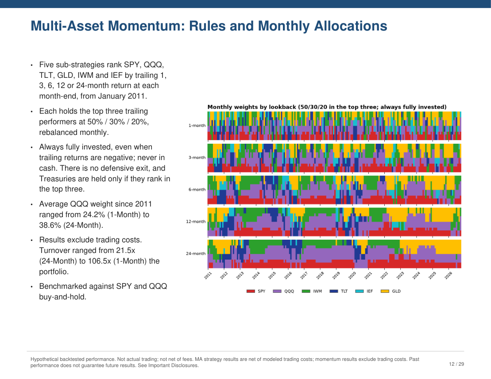
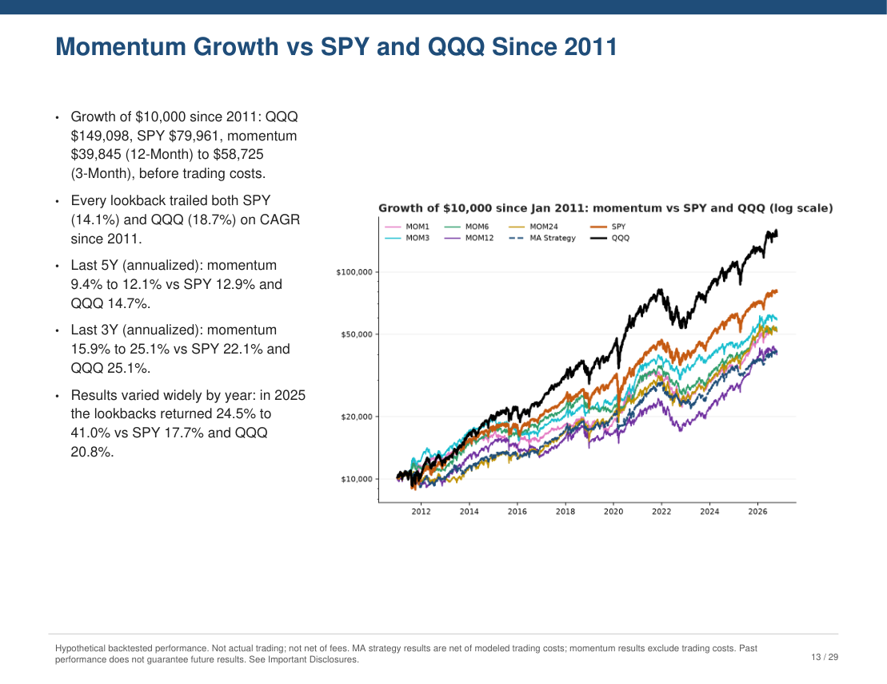
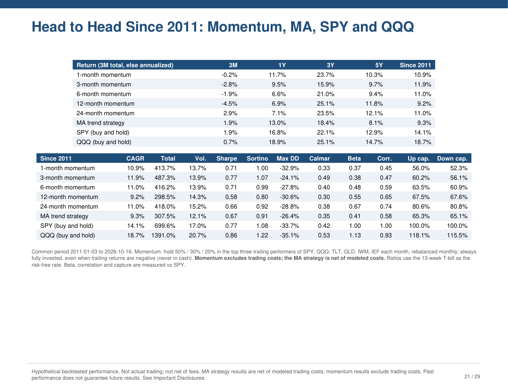
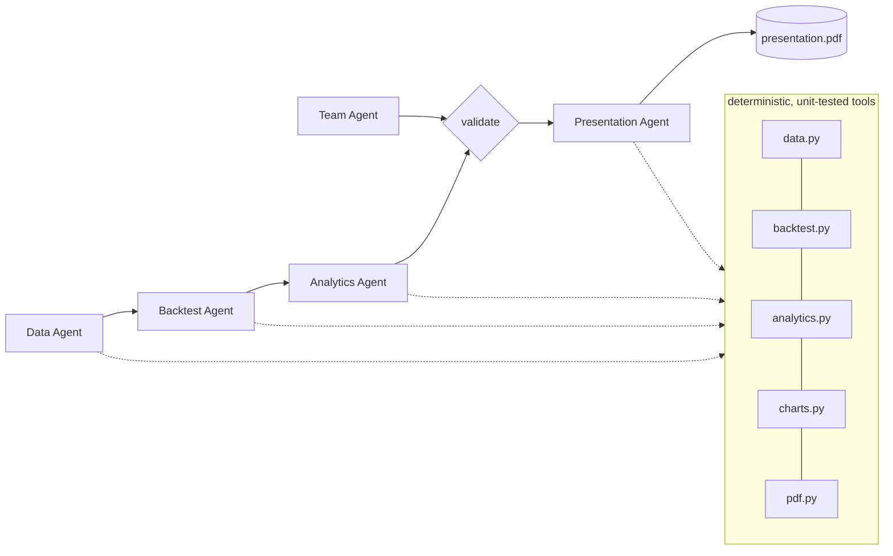
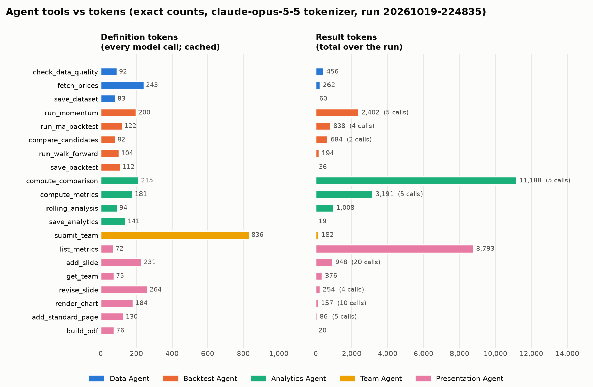

# Replicating an Asset Management Firm with Agents and Task Decomposition

[](https://github.com/emitby/Replicating-an-Asset-Management-Firm-with-Agents-and-Task-Decomposition/actions/workflows/ci.yml)


[](LICENSE)

An asset management firm takes an investment idea from raw data to a client-ready pitch through specialized teams: data operations, quantitative research, performance analytics, investor relations, and the investment team itself. This project **decomposes that workflow into tasks and gives each one to a Claude agent**. The output is a complete investor presentation PDF that researches, compares and presents **two strategies**:

1. **SPY/IEF trend rotation:** hold SPY when it's above a moving average, otherwise IEF. The average (5/20/50/200 days) is chosen yearly by walk-forward. Runs from 2007, net of costs.
2. **Multi-asset momentum:** five sub-strategies with 1, 3, 6, 12 and 24-month lookbacks. Each month, hold **50% / 30% / 20% in the top three** trailing performers among SPY, QQQ, TLT, GLD, IWM and IEF. It is **always fully invested and never holds cash**, even when trailing returns are negative. Runs from 2011, before costs, benchmarked against **SPY and QQQ**.

| Firm function | Agent | Task |
|---|---|---|
| Data operations | **Data Agent** | Source, validate and certify market data for 6 ETFs plus the T-bill rate |
| Quantitative research | **Backtest Agent** | Backtest the MA rules (walk-forward) and 5 momentum lookbacks without hindsight |
| Performance and risk analytics | **Analytics Agent** | Measure return and risk by period, compare momentum vs MA vs SPY since 2011, and write findings |
| Investor relations and marketing | **Presentation Agent** | Write the pitch, including a Pro/Con slide per momentum lookback, choose the charts and build the PDF |
| Investment team | **Team Agent** | Staff a fictional PM and 5 analysts with credentials |
| Compliance | **Guardrails** (code) | Verify every number, block promissory language, add disclosures |
| Operations and oversight | **Harness** (code) | Sequence the work, validate each hand-off, trace and cost every step |

**→ [Example output PDF](docs/example/presentation.pdf)** (29 pages, generated by the final verified run) · **[Full results](docs/results.md)** · **[How the agentic workflow works](docs/agentic-workflows.md)**

<p align="center">
  
  
  
  
</p>

In more detail, five Claude agents take both strategies from raw market data to an investor-ready PDF:

1. **Data Agent:** pulls SPY, QQQ, TLT, GLD, IWM, IEF and the T-bill rate from Yahoo Finance and certifies the data.
2. **Backtest Agent:** tests 5/20/50/200-day moving-average switching rules and picks one each year **using only prior data**. It also runs the five momentum lookbacks (1/3/6/12/24 months, 50/30/20 in the top three, always fully invested).
3. **Analytics Agent:** measures return and risk over **3 months, 1 year, 3 years, 5 years** and since inception, plus a **head-to-head of all five momentum lookbacks vs the MA strategy vs SPY and QQQ since 2011**, with a cost-sensitivity analysis.
4. **Presentation Agent:** writes the pitch, with **a Pro/Con slide for each momentum lookback** and a comparison against MA, SPY and QQQ. It chooses the charts and builds the PDF.
5. **Team Agent:** creates a *fictional* digital investment team (a portfolio manager and 5 analysts, with education, certifications and career history) for the PDF.

| Document | What's in it |
|---|---|
| [docs/results.md](docs/results.md) | Every result table, the pros and cons by sub-strategy, momentum behavior, caveats |
| [docs/agentic-workflows.md](docs/agentic-workflows.md) | Task decomposition, the agent loop, a real run agent by agent, self-correction statistics, orchestration, guardrail layers, the build/review loop, cost profile |
| [docs/strategy-methodology.md](docs/strategy-methodology.md) | Exact rules and formulas for both strategies, metrics, data handling |
| [docs/agents.md](docs/agents.md) | Each agent's tools, preconditions and artifacts |
| [docs/architecture.md](docs/architecture.md) | Code layers, run directory, CLI |
| [docs/harness.md](docs/harness.md) | The orchestrator and agent runtime in detail: stages, hand-off validators, tool execution and error feedback, limits, trace event schema, cost, manifest |
| [docs/guardrails.md](docs/guardrails.md) | Guardrail engineering: the harm each guardrail prevents, where and how it's enforced, its tests, its limits, and design lessons |
| [docs/evals.md](docs/evals.md) | All 5 eval layers: 101 unit tests by file, the 14 scorers and how each works, the 43 red-team cases, the independent cross-check, live trials, and every defect found and how |
| [docs/tools-and-tokens.md](docs/tools-and-tokens.md) | All 21 agent tools, what each enforces, and **exact token counts** per tool and per agent, with a chart |

Guardrails enforced in code, a deterministic harness with tracing and cost accounting, and an eval suite make the output reproducible and checkable.

→ [Methodology](docs/strategy-methodology.md) · [Agents](docs/agents.md) · [Architecture](docs/architecture.md) · [Harness](docs/harness.md) · [Guardrails](docs/guardrails.md) · [Evals](docs/evals.md) · [Tools and tokens](docs/tools-and-tokens.md)

---

## The strategies

**MA trend rotation.** Hold **SPY** when it closed above its N-day moving average yesterday, otherwise hold **IEF** (7–10 year Treasuries). Every January, N ∈ {5, 20, 50, 200} is re-chosen by the best Sharpe ratio over all *prior* years (**walk-forward**), so the reported results are out-of-sample rather than the best rule picked with hindsight. Each switch costs 5 bps.

**Multi-asset momentum.** At each month-end, rank SPY, QQQ, TLT, GLD, IWM and IEF by trailing return over **1, 3, 6, 12 or 24 months** (five separate sub-strategies), and hold **50% / 30% / 20%** in the top three for the next month, drifting until the next month-end rebalance. It is **always fully invested**: a top-three ETF is held even if its trailing return is negative, and there is no cash rule of any kind. (v2 sent negative slots to cash and had a 3-month all-cash lock. The comparison is in [docs/results.md](docs/results.md).) It runs from January 2011 and excludes trading costs, which is your choice; a cost-sensitivity table quantifies the effect.

Both use adjusted closes, so returns include dividends. Details: [docs/strategy-methodology.md](docs/strategy-methodology.md).

## Results from the live run of 2026-10-16

Hypothetical backtest, out-of-sample from 2007-01-03:

| Since 2007 | Strategy | SPY |
|---|---|---|
| CAGR | 7.6% | 10.9% |
| Volatility | 12.4% | 19.5% |
| Max drawdown | −26.4% | −55.2% |
| Sharpe | 0.53 | 0.55 |
| Beta | 0.29 | 1.00 |

**Momentum vs MA vs SPY, January 2011 to October 2026** (full table in [docs/strategy-methodology.md](docs/strategy-methodology.md#strategy-2-multi-asset-momentum-5-sub-strategies-top-3-weighted-always-invested)):

| Since 2011 (momentum v3: 50/30/20 top three, always invested) | CAGR | Volatility | Sharpe | Max DD |
|---|---|---|---|---|
| 1-month momentum | 10.9% | 13.7% | 0.71 | −32.9% |
| **3-month momentum** | **11.9%** | 13.9% | **0.77** | **−24.1%** |
| 6-month momentum | 11.0% | 13.9% | 0.71 | −27.8% |
| 12-month momentum | 9.2% | 14.3% | 0.58 | −30.6% |
| 24-month momentum | 11.0% | 15.2% | 0.66 | −28.8% |
| MA trend strategy | 9.3% | 12.1% | 0.67 | −26.4% |
| SPY | 14.1% | 17.0% | 0.77 | −33.7% |
| **QQQ** | **18.7%** | 20.7% | **0.86** | −35.1% |

**QQQ beat every approach on return and Sharpe.** No momentum lookback beat SPY or QQQ on return. The 3-month lookback was the best momentum variant: its Sharpe equaled SPY's, and its drawdown was the shallowest of the lookbacks.

**Removing cash raised momentum returns but deepened drawdowns.** CAGR rose for 4 of 5 lookbacks compared with v2; the largest change was the 1-month, from 7.3% to 10.9%. Max drawdowns worsened for every lookback except the 24-month, and the 1-month deepened from −22.8% to −32.9%. Momentum excludes trading costs, but charging it 5 bps per unit of turnover lowers its CAGR by only 0.1–0.3% a year. Details: [docs/results.md](docs/results.md).

**The MA strategy trades return for a smoother ride. It does not improve risk-adjusted return.** It roughly halved SPY's worst drawdown, with much lower volatility and beta. But it trailed SPY's return, its Sharpe ratio was slightly *lower* since 2007, **a plain 60/40 portfolio beat it since 2007 on both return (8.4% vs 7.6%) and Sharpe (0.63 vs 0.53)**, and over the last 5 years its drawdown was worse than SPY's because of the 2022 stock-and-bond selloff. The walk-forward chose the 200-day MA in 16 of 20 years and the 50-day in 4. The deck states all of this. A code check refuses to build the PDF until every period where the strategy did worse than SPY has been acknowledged.

## Quick start

Requires Python 3.10+ and an [Anthropic API key](https://console.anthropic.com/) in `ANTHROPIC_API_KEY`.

```powershell
python -m venv .venv
.venv\Scripts\python.exe -m pip install --no-cache-dir -r requirements.txt

.\run.ps1 test          # 101 unit tests, offline, free
.\run.ps1 run           # live pipeline: about 4–5 minutes, about $1
.\run.ps1 eval          # score the latest run + 43 red-team cases (free)
```

On macOS or Linux, use `./run.sh` with the same subcommands.

The PDF is written to `runs/<timestamp>/presentation.pdf`. Run `.\run.ps1 render-pages runs\<timestamp>` to get PNG previews.

> **Always use the launcher** (`run.ps1` / `run.sh`). It keeps matplotlib and Python caches inside the project, as the project guardrails require.

## What's in the PDF

| Section | Written by |
|---|---|
| Cover | Code |
| **Executive Summary with a verdict across both strategies** (required by code), the problem, how the MA strategy works, performance vs SPY, drawdowns, performance by period (3M/1Y/3Y/5Y), when it lags | **Presentation Agent**: every number is verified |
| **Momentum section:** design and holdings, **a Pros/Cons slide for each of the 1/3/6/12/24-month lookbacks** (Cons must cover every metric where it trailed SPY), momentum vs MA vs SPY and QQQ, growth and drawdowns, portfolio fit, next steps | **Presentation Agent** |
| Risk and return table by period: Strategy, SPY and the 60/40 block | Code, from `analytics.json` |
| In-sample comparison of each MA, labeled **IN-SAMPLE** | Code |
| **Head to Head Since 2011:** returns by window and full risk metrics for all 6 series | Code |
| **Momentum Detail:** calendar years, activity, % of months in each ETF, **cost sensitivity at 5 bps per trade**, growth of $10,000 | Code |
| **Meet the Digital Investment Team (AI-generated, fictional)** (2 pages, 6 cards) | **Team Agent** content, rendered by code with the fictional label in the page title and on every card |
| Supporting data, footers on every performance page (stating both strategies' cost treatment), Important Disclosures | Code |

Charts available:
- **MA strategy:** growth of $10,000 vs SPY and 60/40 (log scale), drawdowns, rolling 1-year returns, SPY/IEF allocation, trailing-period returns, the MA chosen each year, calendar-year returns
- **Momentum:** growth since 2011 for all six series, drawdowns, a month-by-month 50/30/20 holdings heatmap, returns-by-window comparison bars

## How the pieces fit



**Agents decide, code computes.** Agents choose which tools to run and write the prose. Every number, chart, table and disclosure comes from tested code, and a guardrail rejects any number in agent prose that isn't in the computed results. See [docs/architecture.md](docs/architecture.md).

## Guardrails at a glance

- **Project:** following [CLAUDE.md](CLAUDE.md), there's no `import os`, all file access is confined to this folder, nothing is deleted, and caches are kept inside the project. Tests enforce this.
- **Numbers:** every number an agent writes must match a computed value at the precision written. 227 numbers were checked in the first live deck.
- **Language:** blocks guarantees, certainty about the future, "risk-free" and similar claims, and urgency or timing calls.
- **Disclosures** are added by code, not by agents. In-sample results are always labeled.
- **Personas:** fictional employers only, no famous names, certification allowlist, experience consistent with career dates. Personas may appear **only** on the labeled team pages and never as contacts.
- **Agents:** least-privilege tools, enums, preconditions, turn limits, a token budget, refusal handling.

Full list: [docs/guardrails.md](docs/guardrails.md).

## Evals at a glance

| Layer | Command | What it proves |
|---|---|---|
| Unit tests (101) | `run.ps1 test` | Correct math, **no look-ahead** for both strategies, walk-forward uses only past data, momentum ranking, always-invested rule (and the v2 cash rules), guardrails including their false positives, PDF disclosures, agent preconditions, confinement |
| Run scorers (14) | `run.ps1 eval` | Both strategies reproduce from saved prices, every lookback and Pro/Con slide is present, the narrative is 100% faithful and traceable, the pitch is balanced, compliance, team quality, PDF structure, cost |
| Red-team (43) | included in `eval` | Guardrails block invented numbers, guarantees, urgency, real firms, famous names, persona contacts and path escapes, and allow benign look-alikes |
| Independent cross-check | `python evals\crosscheck_momentum.py runs\<id>` | Momentum re-derived from prices by code that shares nothing with the project's momentum module |
| Live trials | `run.ps1 eval --live --trials 3` | Pass rates across non-deterministic agent runs |

See [docs/evals.md](docs/evals.md).

## Agent tools and token usage

The five agents can act only through **21 tools**. Each is a Python function with a JSON schema that enforces its own rules. The chart shows the exact tokens each tool costs, measured with the token-counting endpoint on a live run: its **definition**, sent on every model call (and cached), and its **results** over the run.



Results, not definitions, drive cost. The Presentation Agent's `list_metrics` result (8.8K tokens) stays in its context for 13 more turns, which makes that agent about 63% of the run's cost. Prompt caching keeps the whole run at about $1. Per-tool catalog and per-agent table: [docs/tools-and-tokens.md](docs/tools-and-tokens.md). The evals were strengthened after a visual review of the first deck found problems the original scorers missed. The story is in [docs/evals.md](docs/evals.md#lessons-from-the-first-live-run).

## Project layout

```
strategy/            core package
  config.py paths.py data.py backtest.py analytics.py charts.py pdf.py team.py guardrails.py
  context.py harness.py cli.py
  agents/            runtime.py display.py data_agent.py backtest_agent.py analytics_agent.py
                     team_agent.py presentation_agent.py
evals/               scorers.py redteam.py run_evals.py crosscheck_momentum.py token_profile.py token_chart.py results/
tests/               unit tests (synthetic data + scripted fake Claude client)
docs/                methodology, agents, architecture, harness, guardrails, evals, tools-and-tokens, images/
runs/<timestamp>/    one folder per run: artifacts, trace.jsonl, manifest.json, presentation.pdf
docs/example/        the final run's presentation.pdf and page previews
CLAUDE.md            working rules and guardrails for AI coding agents on this repo (followed throughout the build)
tasks/               the build plan (todo.md) and lessons learned (lessons.md), kept per CLAUDE.md
CONTRIBUTING.md      ground rules for changes
run.ps1 / run.sh     launchers
```

## Important

All performance is **hypothetical and backtested**. The investment team is **fictional**. This project is a research prototype and is not investment advice. Data comes from Yahoo Finance via the unofficial `yfinance` library, for personal and research use.

## How this was built

The project was built by Claude Code under the [CLAUDE.md](CLAUDE.md) in this repo:

- plan mode first, with a written plan in [tasks/todo.md](tasks/todo.md)
- subagents for independent visual reviews of the generated PDF
- verification before calling anything done
- a lessons log in [tasks/lessons.md](tasks/lessons.md)
- strict filesystem guardrails: no `os`, nothing outside the folder, no deletions

It took two visual reviews and five rounds of live trials to get from "all automated checks pass" to "the deck is actually right". That history is in [docs/evals.md](docs/evals.md#lessons-from-the-first-live-run).

## License

[MIT](LICENSE) © 2026 Edward Mitby
