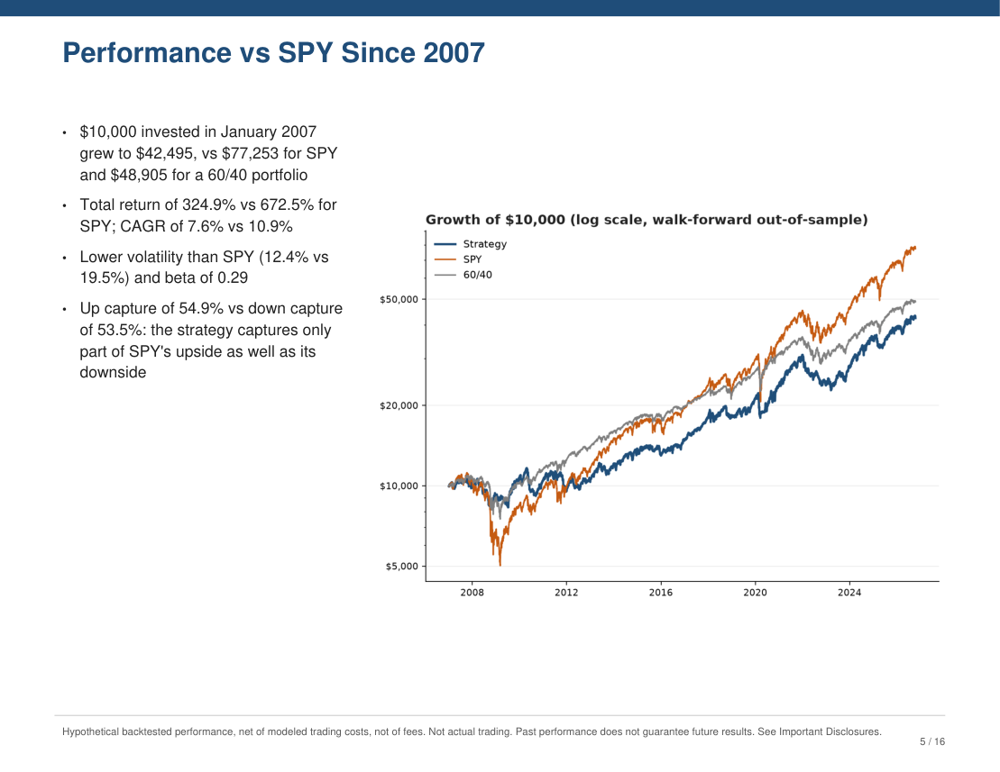
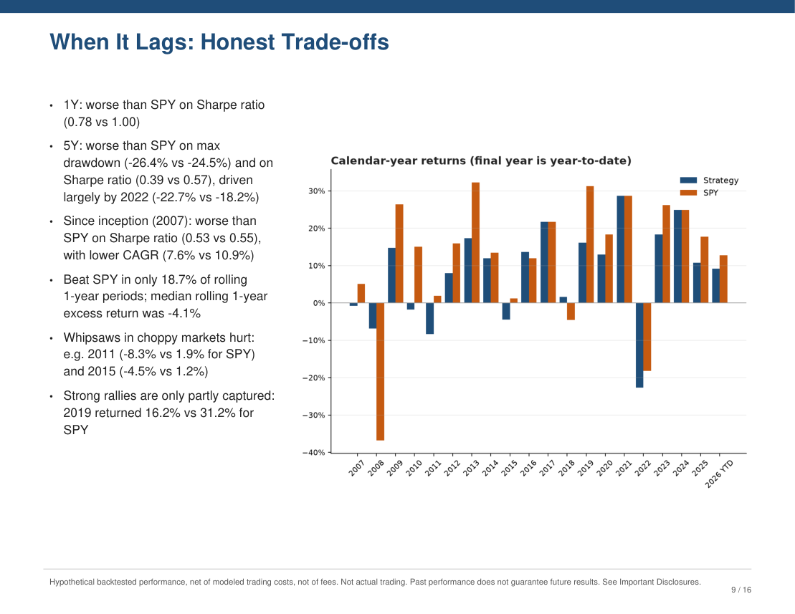
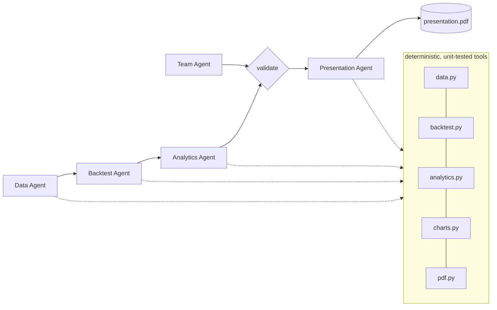

# Replicating an Asset Management Firm with Agents and Task Decomposition

[](https://github.com/emitby/Replicating-an-Asset-Management-Firm-with-Agents-and-Task-Decomposition/actions/workflows/ci.yml)


[](LICENSE)

An asset management firm takes an investment idea from raw data to a client-ready pitch through specialized teams: data operations, quantitative research, performance analytics, investor relations, and the investment team itself. This project **decomposes that workflow into tasks and gives each one to a Claude agent**. The example strategy is a SPY/IEF moving-average rotation, and the output is a complete investor presentation PDF.

| Firm function | Agent | Task |
|---|---|---|
| Data operations | **Data Agent** | Source, validate and certify market data |
| Quantitative research | **Backtest Agent** | Test the candidate rules and select one without hindsight |
| Performance and risk analytics | **Analytics Agent** | Measure return and risk by period, and write committee findings |
| Investor relations and marketing | **Presentation Agent** | Write the pitch, choose the charts and build the PDF |
| Investment team | **Team Agent** | Staff a fictional PM and 5 analysts with credentials |
| Compliance | **Guardrails** (code) | Verify every number, block promissory language, add disclosures |
| Operations and oversight | **Harness** (code) | Sequence the work, validate each hand-off, trace and cost every step |

**→ [Example output PDF](docs/example/presentation.pdf)** (16 pages, generated by the final verified run)

<p align="center">
  
  
  
  
</p>

In more detail, five Claude agents take a systematic strategy from raw market data to an investor-ready PDF:

1. **Data Agent:** pulls SPY, IEF and the T-bill rate from Yahoo Finance and certifies the data.
2. **Backtest Agent:** tests 5/20/50/200-day moving-average switching rules, and picks the best one each year **using only prior data**.
3. **Analytics Agent:** measures return and risk over **3 months, 1 year, 3 years, 5 years** and since inception, against SPY and 60/40.
4. **Presentation Agent:** writes the pitch, chooses the charts and builds the PDF.
5. **Team Agent:** creates a *fictional* digital investment team (a portfolio manager and 5 analysts, with education, certifications and career history) for the PDF.

Guardrails enforced in code, a deterministic harness with tracing and cost accounting, and an eval suite make the output reproducible and checkable.

→ [Methodology](docs/strategy-methodology.md) · [Agents](docs/agents.md) · [Architecture](docs/architecture.md) · [Harness](docs/harness.md) · [Guardrails](docs/guardrails.md) · [Evals](docs/evals.md)

---

## The strategy in one paragraph

Hold **SPY** when it closed above its N-day moving average yesterday, otherwise hold **IEF** (7–10 year Treasuries). Every January, N ∈ {5, 20, 50, 200} is re-chosen by the best Sharpe ratio over all *prior* years (**walk-forward**), so the reported results are out-of-sample rather than the best rule picked with hindsight. Each switch costs 5 bps. Returns use adjusted closes, so they include dividends. Details: [docs/strategy-methodology.md](docs/strategy-methodology.md).

## Results from the live run of 2026-10-16

Hypothetical backtest, out-of-sample from 2007-01-03:

| Since 2007 | Strategy | SPY |
|---|---|---|
| CAGR | 7.6% | 10.9% |
| Volatility | 12.4% | 19.5% |
| Max drawdown | −26.4% | −55.2% |
| Sharpe | 0.53 | 0.55 |
| Beta | 0.29 | 1.00 |

**The strategy trades return for a smoother ride. It does not improve risk-adjusted return.** It roughly halved SPY's worst drawdown, with much lower volatility and beta. But it trailed SPY's return, its Sharpe ratio was slightly *lower* since 2007, and over the last 5 years its drawdown was worse than SPY's because of the 2022 stock-and-bond selloff. The walk-forward chose the 200-day MA in 16 of 20 years and the 50-day in 4. The deck states all of this. A code check refuses to build the PDF until every period where the strategy did worse than SPY has been acknowledged.

## Quick start

Requires Python 3.10+ and an [Anthropic API key](https://console.anthropic.com/) in `ANTHROPIC_API_KEY`.

```powershell
python -m venv .venv
.venv\Scripts\python.exe -m pip install --no-cache-dir -r requirements.txt

.\run.ps1 test          # 75 unit tests, offline, free
.\run.ps1 run           # live pipeline: about 2 minutes, about $0.40
.\run.ps1 eval          # score the latest run + 39 red-team cases (free)
```

On macOS or Linux, use `./run.sh` with the same subcommands.

The PDF is written to `runs/<timestamp>/presentation.pdf`. Run `.\run.ps1 render-pages runs\<timestamp>` to get PNG previews.

> **Always use the launcher** (`run.ps1` / `run.sh`). It keeps matplotlib and Python caches inside the project, as the project guardrails require.

## What's in the PDF

| Section | Written by |
|---|---|
| Cover | Code |
| Executive summary, the problem, how it works, performance vs SPY, drawdowns, performance by period (3M/1Y/3Y/5Y), when it lags, portfolio fit, next steps | **Presentation Agent**: every number is verified |
| Risk and return table by period: Strategy, SPY and the 60/40 block | Code, from `analytics.json` |
| In-sample comparison of each MA, labeled **IN-SAMPLE** | Code |
| **Meet the Digital Investment Team** (2 pages, 6 cards) | **Team Agent** content, rendered by code with an *AI-generated fictional persona* stamp on every card |
| Footers on every performance page, Important Disclosures page | Code |

Charts available: growth of $10,000 vs SPY and 60/40 (log scale), drawdowns, rolling 1-year returns, SPY/IEF allocation over time, trailing-period returns, the MA chosen each year, and calendar-year returns.

## How the pieces fit



**Agents decide, code computes.** Agents choose which tools to run and write the prose. Every number, chart, table and disclosure comes from tested code, and a guardrail rejects any number in agent prose that isn't in the computed results. See [docs/architecture.md](docs/architecture.md).

## Guardrails at a glance

- **Project:** following [CLAUDE.md](CLAUDE.md), there's no `import os`, all file access is confined to this folder, nothing is deleted, and caches are kept inside the project. Tests enforce this.
- **Numbers:** every number an agent writes must match a computed value at the precision written. 227 numbers were checked in the first live deck.
- **Language:** blocks guarantees, certainty about the future, "risk-free" and similar claims, and urgency or timing calls.
- **Disclosures** are added by code, not by agents. In-sample results are always labeled.
- **Personas:** fictional employers only, no famous names, certification allowlist, experience consistent with career dates. Personas may appear **only** on the labeled team pages and never as contacts.
- **Agents:** least-privilege tools, enums, preconditions, turn limits, a token budget, refusal handling.

Full list: [docs/guardrails.md](docs/guardrails.md).

## Evals at a glance

| Layer | Command | What it proves |
|---|---|---|
| Unit tests (75) | `run.ps1 test` | Correct math, **no look-ahead**, walk-forward uses only past data, guardrails, PDF disclosures, agent preconditions, confinement |
| Run scorers (11) | `run.ps1 eval` | The run's numbers reproduce, the narrative is 100% faithful and traceable, the pitch is balanced, compliance, team quality, PDF structure, cost |
| Red-team (39) | included in `eval` | Guardrails block invented numbers, guarantees, urgency, real firms, famous names, persona contacts and path escapes, and allow benign look-alikes |
| Live trials | `run.ps1 eval --live --trials 3` | Pass rates across non-deterministic agent runs |

See [docs/evals.md](docs/evals.md). The evals were strengthened after a visual review of the first deck found problems the original scorers missed. The story is in [docs/evals.md](docs/evals.md#lessons-from-the-first-live-run).

## Project layout

```
strategy/            core package
  config.py paths.py data.py backtest.py analytics.py charts.py pdf.py team.py guardrails.py
  context.py harness.py cli.py
  agents/            runtime.py display.py data_agent.py backtest_agent.py analytics_agent.py
                     team_agent.py presentation_agent.py
evals/               scorers.py redteam.py run_evals.py results/
tests/               unit tests (synthetic data + scripted fake Claude client)
docs/                methodology, agents, architecture, harness, guardrails, evals
runs/<timestamp>/    one folder per run: artifacts, trace.jsonl, manifest.json, presentation.pdf
docs/example/        the final run's presentation.pdf and page previews
CLAUDE.md            working rules and guardrails for AI coding agents on this repo (followed throughout the build)
tasks/               the build plan (todo.md) and lessons learned (lessons.md), kept per CLAUDE.md
CONTRIBUTING.md      ground rules for changes
run.ps1 / run.sh     launchers
```

## Important

All performance is **hypothetical and backtested**. The investment team is **fictional**. This project is a research prototype and is not investment advice. Data comes from Yahoo Finance via the unofficial `yfinance` library, for personal and research use.

## How this was built

The project was built by Claude Code under the [CLAUDE.md](CLAUDE.md) in this repo:

- plan mode first, with a written plan in [tasks/todo.md](tasks/todo.md)
- subagents for independent visual reviews of the generated PDF
- verification before calling anything done
- a lessons log in [tasks/lessons.md](tasks/lessons.md)
- strict filesystem guardrails: no `os`, nothing outside the folder, no deletions

It took two visual reviews and five rounds of live trials to get from "all automated checks pass" to "the deck is actually right". That history is in [docs/evals.md](docs/evals.md#lessons-from-the-first-live-run).

## License

[MIT](LICENSE) © 2026 Edward Mitby
