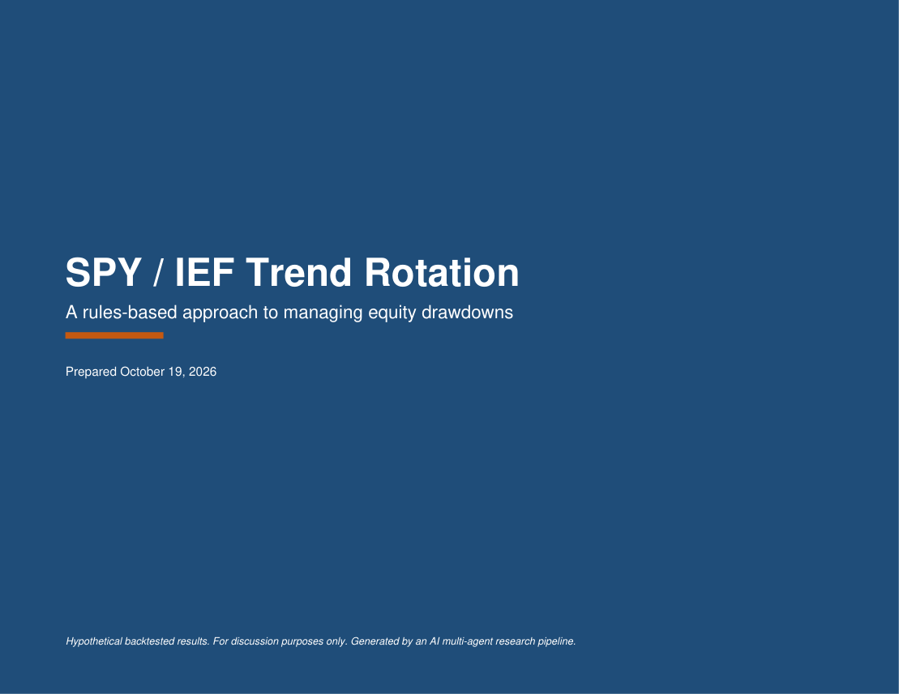
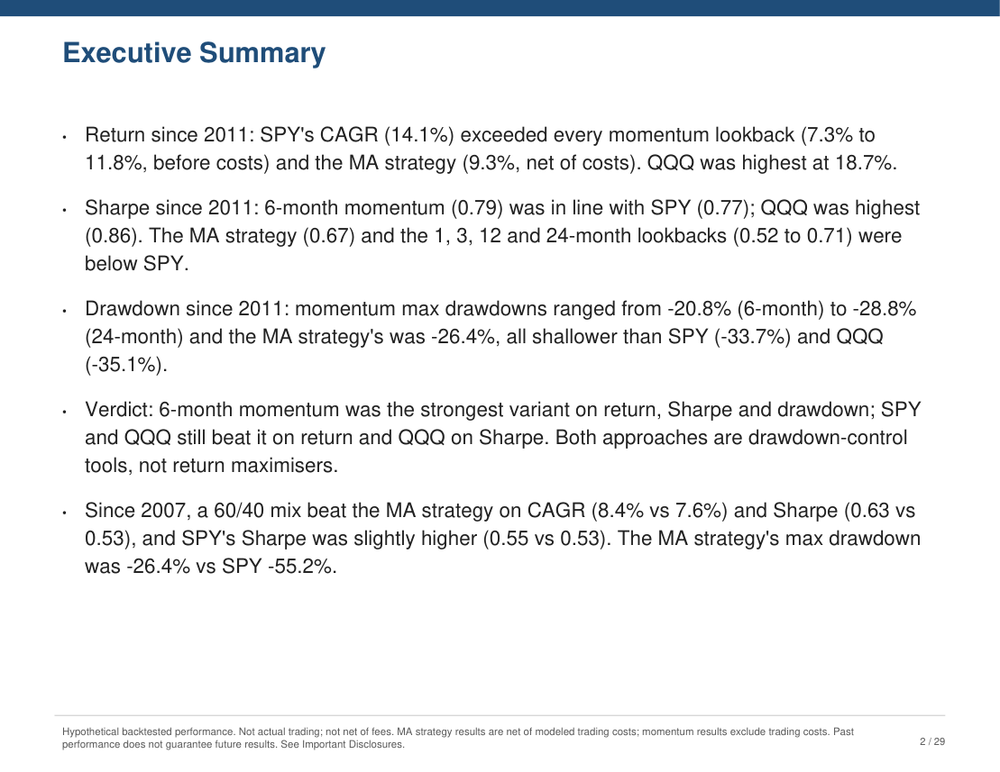
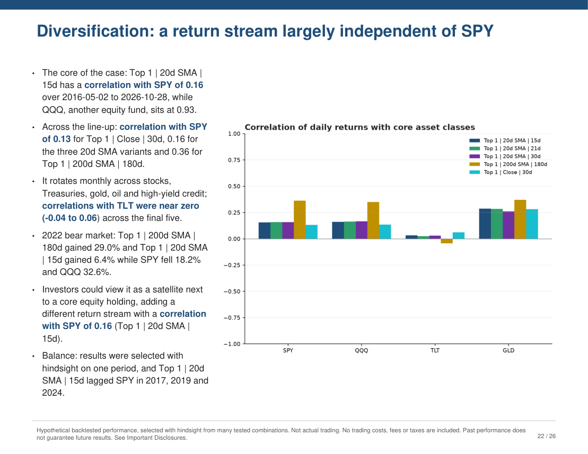
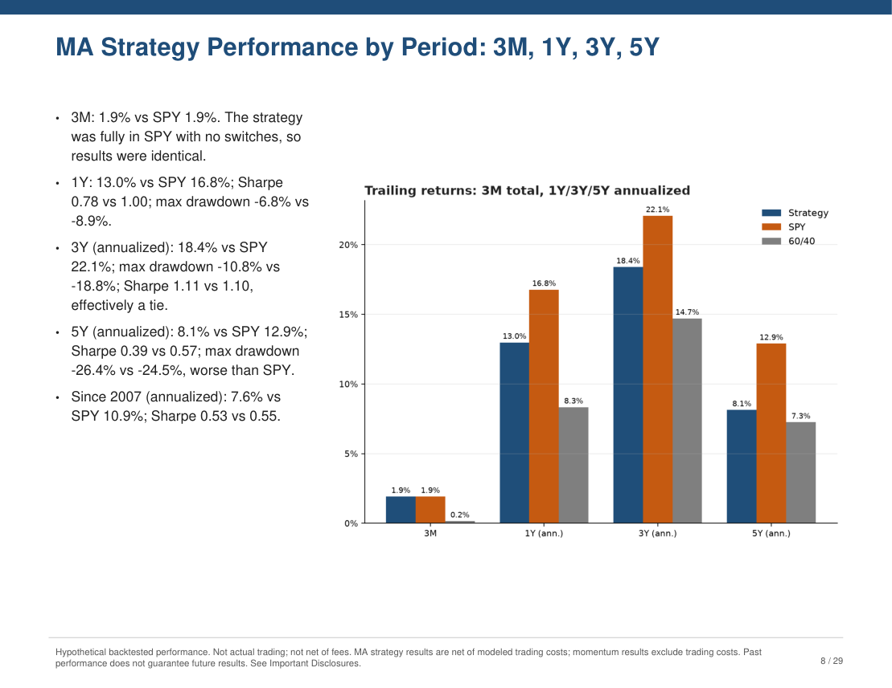
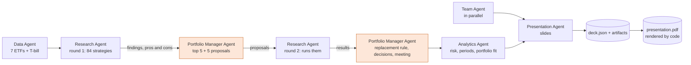
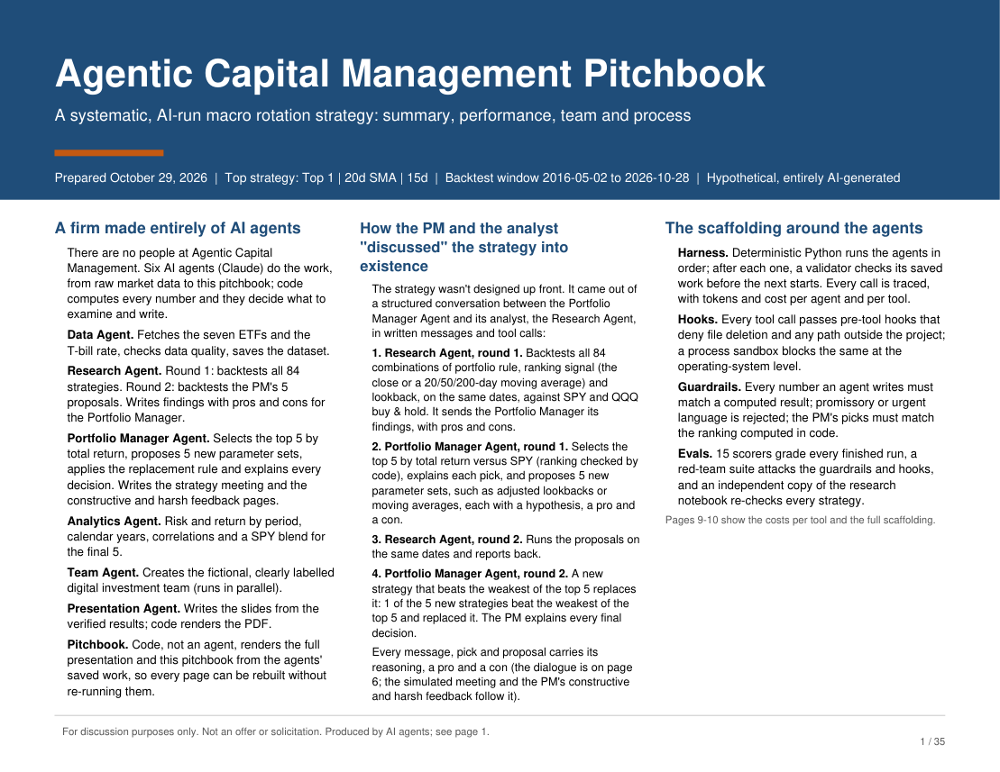
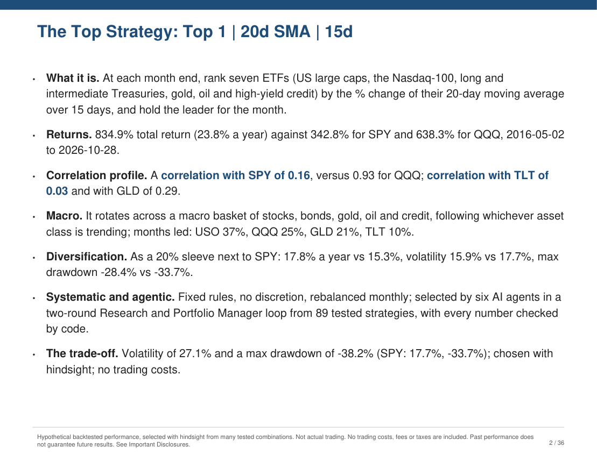
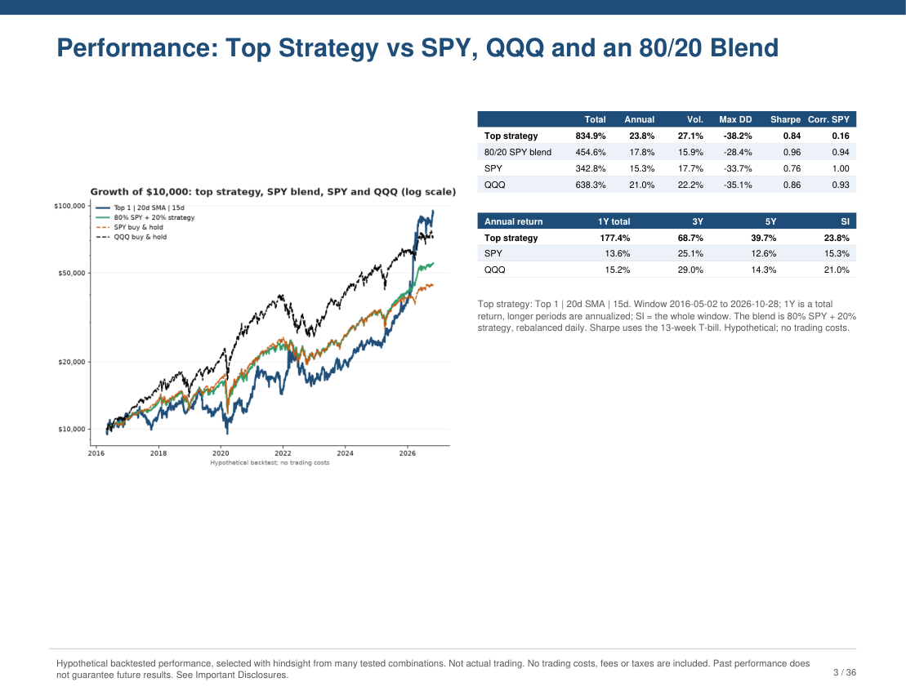

# Replicating an Asset Management Firm with Agents and Task Decomposition

**Six Claude agents run "Agentic Capital Management": they download market data, backtest 84 ETF-ranking strategies, have a Portfolio Manager agent pick, challenge and refine them with a Research agent over two rounds, and publish a 26-page investor PDF in which code verifies every number.**

[](https://github.com/emitby/Replicating-an-Asset-Management-Firm-with-Agents-and-Task-Decomposition/actions/workflows/ci.yml)
[](https://github.com/emitby/Replicating-an-Asset-Management-Firm-with-Agents-and-Task-Decomposition/actions/workflows/evals.yml)


[](LICENSE)

<p align="center">
  
  
  
  
</p>

**→ [Example PDF: Agentic Capital Management Strategy Presentation](docs/example/presentation.pdf)** (26 pages) · **[Pitchbook](docs/example/pitchbook.pdf)** (12 pages + appendix) · **[Results](docs/results.md)** · **[How the agents work together](docs/agentic-workflows.md)** · **[Evals](docs/evals.md)** · **[Hooks and guardrails](docs/guardrails.md)**

## Results

| Eval | Result |
|---|---|
| Live trials of the full pipeline (non-deterministic agents), final code | **14 / 14 scorers in 3 of 3 trials**, $1.16–1.20 and 293–314 s each |
| Red-team: invented numbers, promises, rigged PM decisions, delete commands, out-of-project paths | **74 / 74**, with benign look-alikes allowed |
| Independent cross-check: the research notebook's own code re-runs all 89 strategies | **Match** on every daily return of all 89 (largest difference 8e-16, floating-point rounding) |
| Unit tests (engine, agents, hooks, sandbox, cost accounting, PDF) | **158 / 158 passing** |
| Numbers in agent prose | Every one must match a computed value at the precision written, or the text is rejected |

## What it does



1. **Data Agent.** Downloads adjusted daily prices for SPY, QQQ, TLT, IEF, GLD, USO and JNK, plus the T-bill rate, from 2015. It checks quality and keeps completed sessions only.
2. **Research Agent, round 1.** Backtests the notebook's full grid: 3 portfolio rules × 4 signals (the close, or a 20/50/200-day SMA) × 7 lookbacks (15–180 days) = **84 strategies**. All of them are scored on the same dates and compared with SPY and QQQ buy & hold. It sends the PM its findings, which must include pros and cons.
3. **Portfolio Manager Agent, round 1.** Selects the **top 5 by total return vs SPY**. Code computes the ranking, and the PM's pick is accepted only if it matches. The PM then proposes **5 new parameter sets** (adjusted lookbacks or moving averages), each with a hypothesis, a pro and a con.
4. **Research Agent, round 2.** Runs the 5 proposals on the same dates and reports back.
5. **Portfolio Manager Agent, round 2.** Applies the rule: a new strategy that beats the weakest of the top 5 on total return replaces it. The PM explains every keep, add and remove, and writes three simulated one-page scripts with the analyst agents:
   - a **strategy meeting**;
   - **Constructive Feedback**, praising the correlation profiles and the macro-basket returns;
   - **Harsh Feedback**, tearing into the process using the strategies' real cons and implying the analysts should be replaced.
6. **Analytics Agent.** Measures risk and return by period, calendar years, correlations with SPY, QQQ, TLT and GLD, and an 80% SPY + 20% strategy blend for the final 5.
7. **Presentation Agent.** Writes the slides. **Code renders the PDF from saved artifacts**, so the deck can be edited and rebuilt without re-running any agent (`build-pdf`).

## The strategies the agents picked

Example run [`20261029-092959`](docs/results.md), scored 2016-05-02 to 2026-10-28. This is hypothetical and in-sample, with no trading costs.

| Final line-up | Total return | vs SPY | Annual | Max drawdown | Volatility | Sharpe | Corr. SPY |
|---|---|---|---|---|---|---|---|
| Top 1, 20-day SMA, 15-day lookback | 834.9% | +492.1% | 23.8% | −38.2% | 27.1% | 0.84 | 0.16 |
| Top 1, 20-day SMA, 21-day lookback *(added in round 2)* | 811.9% | +469.1% | 23.5% | −34.4% | 27.3% | 0.82 | 0.16 |
| Top 1, 20-day SMA, 30-day lookback | 739.0% | +396.2% | 22.5% | −34.4% | 27.1% | 0.80 | 0.16 |
| Top 1, 200-day SMA, 180-day lookback | 622.1% | +279.3% | 20.8% | −42.2% | 26.7% | 0.75 | 0.36 |
| Top 1, close, 30-day lookback | 611.9% | +269.1% | 20.6% | −37.5% | 26.7% | 0.75 | 0.13 |
| **SPY** buy & hold | 342.8% | — | 15.3% | −33.7% | 17.7% | 0.76 | 1.00 |
| **QQQ** buy & hold | 638.3% | +295.5% | 21.0% | −35.1% | 22.2% | 0.86 | 0.93 |

Correlation is of daily returns over the same window. It's reported for every strategy in the agents' results, both analysis tables and `research.json`.

- **Versus SPY:** every final strategy more than doubled SPY's total return. Each also took more risk: about 27% volatility versus 18%, and deeper worst drawdowns (−34% to −42% versus −34%).
- **Versus QQQ:** only the three 20-day-SMA strategies beat QQQ on total return. None beat QQQ's Sharpe of 0.86, so after risk they roughly match the benchmarks rather than dominate them.
- **The gains are recent:** the leader returned 53.3% in 2025 and 155.0% in 2026 YTD. It lagged badly in strong equity years, for example −0.1% versus SPY's 21.7% in 2017.
- **As a diversifier:** correlation with SPY is low (0.13–0.36, against QQQ's 0.93), because the returns come from rotating across a macro basket of stocks, Treasuries, gold, oil and credit. The PDF highlights these correlation figures wherever it explains the benefits. An 80% SPY + 20% strategy blend historically had a higher return than SPY alone (17.0–17.8% versus 15.3%), lower volatility and a shallower drawdown (−26.1% to −29.7% versus −33.7%).

Full detail, including the round-2 decisions and what the agents said, is in [docs/results.md](docs/results.md).

## Quick start

```powershell
python -m venv .venv
.venv\Scripts\python.exe -m pip install --no-cache-dir -r requirements.txt
.\run.ps1 run          # live pipeline: about 5 minutes, about $1.20 -> runs\<timestamp>\presentation.pdf
```

Needs an [Anthropic API key](https://console.anthropic.com/) in `ANTHROPIC_API_KEY`. `.\run.ps1 test` runs the offline tests for free, including a full scripted six-agent run.

## Commands

| Command | What it does |
|---|---|
| `run.ps1 run [--offline]` | Full pipeline (offline uses cached prices) |
| `run.ps1 build-pdf runs\<id>` | **Rebuild the PDF from a finished run's saved files: no agents, no API cost.** Edit `deck.json` (or the layout code) and rebuild. |
| `run.ps1 build-pitchbook runs\<id>` | Build the short **Pitchbook** (with appendix) from saved files: no agents, no API cost |
| `run.ps1 stage <name> --from runs\<id>` | Re-run one stage (`data`, `research1`, `pm1`, `research2`, `pm2`, `analytics`, `team`, `presentation`) on an earlier run's artifacts |
| `run.ps1 eval [--run runs\<id>] [--live --trials N]` | Score a run with the 15 scorers plus the 74-case red-team suite |
| `run.ps1 render-pages runs\<id> [--pdf pitchbook.pdf]` | Render PDF pages to PNG for visual review |
| `run.ps1 test` | Unit tests |
| `python -m evals.token_profile runs\<id> --markdown out.md` | Exact token counts per tool definition and result, with cost per tool |

`run.sh` has the same commands. Every command first installs the process sandbox (see below).

## What's in the PDF

| Pages | Content | Written by |
|---|---|---|
| 1 | Title; how the agents produced the deck; the Research ↔ PM back-and-forth | Code |
| 2 | Flowchart of the agentic workflow | Code |
| 3–4 | Harness, hooks, this run's **tokens and cost per agent and per tool**, guardrails, evals | Code (from `strategy/governance.py`) |
| 5, 9–11, 13–14, 17, 20–23 | Executive summary, strategy, round 1, PM selection and proposals, round 2, risk, **diversification marketing**; every correlation figure highlighted | Presentation Agent, number-checked |
| 6 | **Simulated strategy meeting** between the PM, Research and Analytics agents | PM Agent, number-checked, labelled simulated |
| 7 | **Constructive Feedback**: the PM praises the correlation profiles and macro-basket returns | PM Agent, number-checked, labelled simulated |
| 8 | **Harsh Feedback**: the PM attacks the analysts' process using the strategies' real cons | PM Agent, number-checked, labelled simulated |
| 12, 19 | **The only two analysis-table pages** (enforced by code and an eval), with correlation with SPY for every strategy | Code |
| 15, 16, 18 | Decision log: every finding, pick, proposal and final decision with its pro and con | Research and PM Agents |
| 24–25 | Fictional digital investment team, every card labelled | Team Agent |
| 26 | Important disclosures | Code |

Exact page numbers vary slightly by run, because the Presentation Agent chooses 1–3 slides per section.

## The Pitchbook

Every run also produces `pitchbook.pdf`: a 12-page pitch followed by an appendix holding every other page of the presentation. Code builds it from the run's saved files, so `build-pitchbook` can rebuild it at any time.

| Page | Content |
|---|---|
| 1 | **How the firm works**: the whole firm is AI agents (each agent's job, from data to pitchbook); how the strategy came out of the Portfolio Manager "discussing" it with the analyst over two rounds; the scaffolding (harness, hooks, guardrails, evals) |
| 2 | **The top strategy and why it makes sense**: returns, correlation profile (highlighted), macro basket, diversification as a 20% SPY sleeve, systematic and agentic, and the trade-off |
| 3 | **Performance**: growth of $10,000 (top strategy, 80/20 SPY blend, SPY, QQQ) and summary statistics overall and by period |
| 4 | **The team**: org chart of the fictional analysts, and the callout "combined real-world investing experience: 0 years" |
| 5 | **Investment Process**: the agentic workflow flowchart |
| 6 | **Investment Process**: the Portfolio Manager ↔ analyst dialogue from the run |
| 7–8 | **Constructive Feedback** and **Harsh Feedback** |
| 9 | **Token Counts and Costs per Tool**: cost-per-tool chart, each tool's calls, input and output tokens and cost, and cost per agent, all adding up to the run's total |
| 10 | **Evals, Hooks, Harness and Guardrails**: one page, four panels, plus this run's activity (tool calls, hook denials, rejected and corrected calls, stages validated) |
| 11 | **Compliance**: "FAKEGIPS compliant" and "FAKECFA Code of Ethics" bullets, with a footnote that both are invented and that the firm claims no real GIPS compliance or CFA Institute affiliation |
| 12 | **Disclosures**: this is all fake, all of it is agentic, zero risk management is applied, past results are no guarantee of future performance |
| 13 | Appendix contents |
| 14+ | Appendix A: strategy and research. B: risk and portfolio fit. C: process and governance. D: investment team. E: full disclosures. |

<p align="center">
  
  
  
</p>

## Hooks, guardrails and harness

- **Runtime hooks** (`strategy/hooks.py`). Every tool call passes through pre-tool hooks:
  - `forbid_delete` denies delete tools and delete commands;
  - `confine_paths` denies paths outside the project.

  A post-tool hook counts calls. A denial reaches the agent as an error it can fix, and it is traced.
- **Process sandbox** (`strategy/sandbox.py`). A Python audit hook blocks file deletion and any read or write outside the project, whatever code asks for it. Reads of the Python installation are allowed, and so are deletes of library scratch files in `.cache/`.
- **Claude Code hook** (`.claude/settings.json` → `.claude/hooks/guard.py`). Developer sessions in this repo can't delete files, or read, write or search outside the project.
- **Guardrails:**
  - numeric faithfulness and compliance language on all agent text;
  - PM decisions correct by construction;
  - comparable tests on identical dates;
  - fictional personas;
  - ticker allowlist and stage validators.
- **Cost tracking:** every model call's tokens and dollars are attributed to the agent and the tool (or context) that caused them. The per-tool costs add up exactly to the run total, and an eval checks it.

Details: [docs/guardrails.md](docs/guardrails.md) · [docs/harness.md](docs/harness.md) · [docs/tools-and-tokens.md](docs/tools-and-tokens.md).

## Project layout

```
strategy/                 the pipeline
  ranking.py              the strategy engine (ported from download_prices.ipynb)
  agents/                 data, research, pm, analytics, team and presentation agents; runtime loop; views
  harness.py              stages, validators, manifest, final re-render
  hooks.py, sandbox.py    tool hooks and the process audit hook
  guardrails.py           numeric faithfulness, compliance language
  governance.py           code-owned descriptions shown in the PDF (tested against the code)
  pdf.py, charts.py       PDF and charts, rendered from saved artifacts only
evals/                    15 scorers, red-team suite, notebook cross-check, token profile and chart
tests/                    158 unit tests incl. a full scripted pipeline run
.claude/                  Claude Code hook (guard.py) and its settings
docs/                     documentation, example PDF and pages
download_prices.ipynb     the research notebook the strategy comes from
```

## Important

All performance is hypothetical and backtested. The final strategies were chosen because they did best among 89 tested on one historical period, so their results benefit from hindsight. No trading costs, fees or taxes are modeled. The team personas are fictional. This is a research prototype, not investment advice.

## License

MIT
