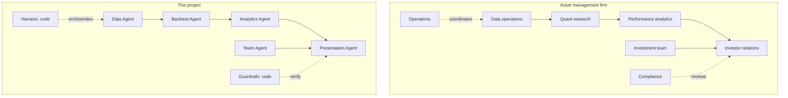
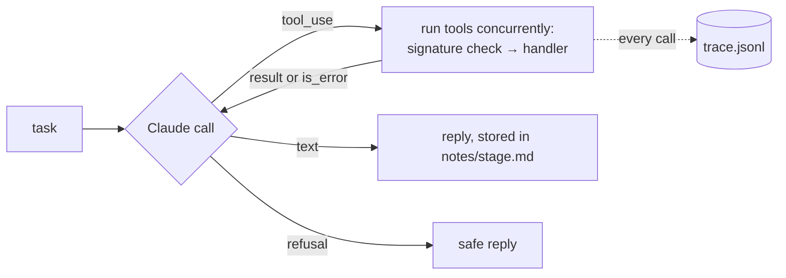
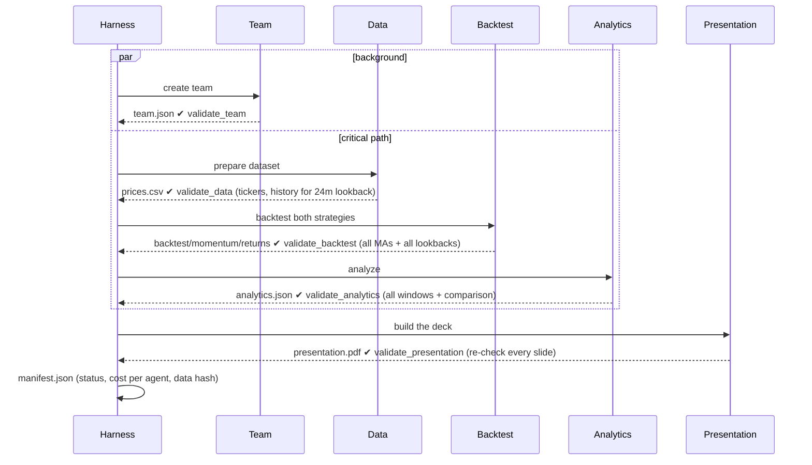
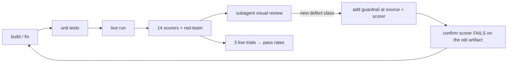

# Agentic workflows: how the firm is replicated

This document explains how the project turns an asset manager's workflow into cooperating agents: the task decomposition, how each agent works, how work moves between them, and how reliability was built up and measured. Every figure here comes from real run traces in this repo's `runs/` directories. Those folders are gitignored, but the trace format is documented in [harness.md](harness.md).

---

## 1. Task decomposition

A real firm takes an idea from data to a client-ready pitch through specialized teams. Each team has a narrow job, clear inputs and outputs, and someone checking its work. The same structure carries over to agents:

| Firm function | Agent / component | Task | Inputs → outputs |
|---|---|---|---|
| Data operations | **Data Agent** | Source and certify prices for 6 ETFs and the T-bill rate | Ticker list, start date → `prices.csv`, `data_report.json` |
| Quant research | **Backtest Agent** | Test 4 MA rules plus walk-forward selection, and 5 momentum lookbacks (50/30/20 in the top three) | Prices → `backtest.json`, `momentum.json`, `returns.csv` |
| Performance analytics | **Analytics Agent** | Metrics for 3M/1Y/3Y/5Y/inception, a head-to-head since 2011, and findings | Returns → `analytics.json` |
| Investor relations | **Presentation Agent** | Narrative, chart choice and slide order, the pitch PDF | Analytics, team → `presentation.pdf` |
| Investment team | **Team Agent** | A fictional PM and 5 analysts with credentials | Strategy description → `team.json` |
| Compliance | **Guardrails** (code) | Numbers, language, disclosures, balance, personas | Every agent-written string |
| Operations | **Harness** (code) | Sequencing, hand-off validation, tracing, cost | All of the above |

**Design rules behind the decomposition**

1. **One agent per function, with a narrow toolset.** An agent's tools are its job description. The Backtest Agent can't write slides, and the Presentation Agent can't change data.
2. **Hand-offs are files, not conversations.** Each agent starts fresh with a short task and reads the previous stage's artifacts through its tools. No agent's context fills up with another agent's work, and any stage can be re-run alone (`run.ps1 stage presentation --from runs/<id>`).
3. **Agents decide, code computes.** Every number, chart, table and disclosure is produced by deterministic, unit-tested Python. Agents choose what to run and explain what it means.
4. **Compliance and operations are code, not agents.** Rules that must hold every time are enforced deterministically. They don't depend on an LLM remembering them.
5. **Independent work runs in parallel.** The Team Agent needs no market data, so it runs alongside Data → Backtest → Analytics.

---

## 2. Anatomy of one agent

Every agent is the same small loop (`strategy/agents/runtime.py`) with a different prompt and toolset:

- **Model:** `claude-opus-5-5` with adaptive thinking, an `effort` level per agent (low for narrow tasks, medium for judgment-heavy ones), prompt caching, and server-side refusal fallbacks.
- **Tools** are Python functions behind JSON schemas with enums. A tool can be called only with valid arguments. Wrong arguments, out-of-order calls and rule violations come back as `is_error` results with a specific message, and the agent fixes them on its next turn.
- **Preconditions are encoded in tools.** "Run the quality check before saving." "Backtest every MA and every momentum lookback before saving." "Compute every comparison window." The agent can't skip a step, because the save tool refuses until the step is done.
- **Limits:** a turn cap per agent, a run-wide token budget, and an append-only conversation history.

### A real run, agent by agent

*This trace is from momentum v1 (top-1, 4 lookbacks). Momentum v2 (50/30/20 top-three, 5 lookbacks, QQQ benchmark) runs took about 3–4 minutes and $0.65–0.80. Momentum v3 (always fully invested) runs take about 4–5 minutes and about $1: the Presentation Agent does more self-correction under the v3 honesty checks, often through `revise_slide`. Per-tool token counts for a v3 run are in [tools-and-tokens.md](tools-and-tokens.md). The agent structure and flow are identical.*

Run `20261019-165936-eval3`: 183 seconds, **$0.65**, about 348K tokens. 83% of input tokens were served from the prompt cache.

| Agent | Model turns | Tool calls | What it did | Cost |
|---|---|---|---|---|
| Team | 2 | `submit_team` ×1 | Six personas, accepted first time | $0.07 |
| Data | 4 | `fetch_prices`, `check_data_quality` ×2, `save_dataset` | Called the quality check before fetching, got "Fetch prices first", corrected itself | $0.04 |
| Backtest | 4 | `run_ma_backtest` ×4, `run_momentum` ×4, `run_walk_forward`, `compare_candidates` ×2, `save_backtest` | Ran 9 independent tools **in one turn, concurrently**. The comparison was rejected until the walk-forward finished, then retried. | $0.04 |
| Analytics | 3 | `compute_metrics` ×5, `compute_comparison` ×5, `rolling_analysis`, `save_analytics` | 11 calls in one turn, then findings passed the number check first time | $0.13 |
| Presentation | 15 | `list_metrics`, `get_team`, `render_chart` ×10, `add_slide` ×18, `add_standard_page` ×5, `build_pdf` | 18 slides, all passing the guardrails as added; built a 27-page deck | $0.38 |

Stage timeline: Team and Data start together. Data finishes at 25 s, Backtest at 45 s and Analytics at 71 s, with Team already done at 27 s. Presentation finishes at 183 s.

### Self-correction across all live runs

Across **24 successful live runs and 1,182 tool calls**:

| Agent | Rejections | Kind |
|---|---|---|
| Backtest | 24 | Called `compare_candidates` in parallel with `run_walk_forward`. The tool requires the walk-forward first. Recovered every time. |
| Data | 4 | Quality check before fetch. Recovered. |
| Presentation | 1 | A slide rejected by the number and language guardrail. Rewritten. |
| Team | 1 | A schema rejection. Resubmitted correctly. |

**Lesson:** content guardrails almost never trigger, because each prompt *describes* the rules the code *enforces*. The guardrail is the safety net, not the primary mechanism. Ordering mistakes are common and harmless, because the tools refuse cleanly and say why.

---

## 3. Orchestration (the harness)

- **Validators between stages** stop a run as soon as a hand-off is incomplete, so a later agent never builds on bad input.
- **Every model call and tool call is traced** (`trace.jsonl`) with inputs, outcome, latency and tokens. The manifest records cost per agent.
- **Single-stage re-runs** reuse saved artifacts, which makes it cheap to iterate on one agent's prompt.

---

## 4. Guardrails in three layers

| Layer | When | Examples |
|---|---|---|
| **At the tool** (the agent can fix it) | As content is created | Every number checked against computed results. Banned promissory and urgency language. Persona names off slides. Pro/Con slides that must cover each lookback's weaknesses. Executive-summary verdict. MA/60/40 balance. Team schema (real firms, famous names, certifications, experience consistent with dates). |
| **At the hand-off** (harness) | After each stage | Artifacts exist and are complete. All slides re-checked before acceptance. |
| **In evals** (after the fact) | On the finished run | 14 scorers re-verify everything independently. 42 red-team cases attack the guardrails. |

Content that must always be right is **owned by code**, not agents:
- the disclosure footer, which states the cost treatment of *both* strategies
- the disclosures page
- the IN-SAMPLE labels
- all tables
- the "AI-generated, fictional" stamp on every persona card and team page title

A design principle that came out of this project: **every figure an agent can see is printed in a code-generated table.** This is *traceability by construction*, enforced by a unit test. Any number a reader finds on a slide, they can also find in a table.

---

## 5. The build process as a workflow

The project itself was built by an agent (Claude Code) under [CLAUDE.md](../CLAUDE.md): plan mode first, subagents for independent review, verification before calling anything done, and a lessons log. Generated output was improved in a repeating loop:

What each step caught (details in [evals.md](evals.md)):

| Caught by | Examples |
|---|---|
| Unit tests | Momentum's initial-purchase cost never charged (a pandas NaN-sum quirk) |
| Live runs | Intraday price used as a close. Windows `\\?\` path breaking confinement under concurrency. |
| Scorer debugging | **A page title silently dropped by the PDF library.** A heuristic in a scorer. |
| Independent cross-check | Nothing: momentum matched a standalone implementation exactly over 190 months |
| Visual reviews (4 rounds) | Personas named as contacts. An urgency title. **A false "net of costs" footer on momentum pages.** 60/40 beating the MA strategy never mentioned. A wrong range. A near-tie claimed as a pro. Unreadable heatmap colors. |
| Live trials (5 rounds) | Intermittent untraceable figures. A bio phrase flagged at eval time but not at submit time. |

**Takeaways for building agentic workflows**

1. **A passing eval suite is necessary but not sufficient.** All automated checks passed several times while the rendered deck still had real problems. Keep a semantic review (human or subagent) in the loop.
2. **Turn each new defect class into a guardrail at the source *and* a scorer, and prove the scorer fails on the bad artifact** before trusting it.
3. **Measure pass rates over several live trials.** Agents aren't deterministic, and one green run proves little.
4. **Prefer guarantees by construction over after-the-fact checks**, as with traceability.
5. **Check at the smallest unit that carries the claim.** A keyword match across a whole slide "acknowledged" a fact the slide never stated. Checking within a single bullet fixed that.
6. **Code-owned boilerplate must be re-read whenever the scope changes.** A footer that was true for one strategy became false when a second was added.

---

## 6. Cost and performance profile

| | Value |
|---|---|
| Live run, both strategies (momentum v3) | About 260 s, **about $1.02** (earlier versions: 100–195 s, $0.31–0.80) |
| Biggest consumer | Presentation Agent, about 63% of cost in v3 (14 turns). See [tools-and-tokens.md](tools-and-tokens.md). |
| Prompt caching | Only 64 of about 440K input tokens were uncached in the v3 profile run; the rest were cache writes and reads |
| Live eval, 3 trials | About 12 minutes, about $2.60 (v3) |
| Unit tests, red-team, independent cross-check | Free, no API calls |
