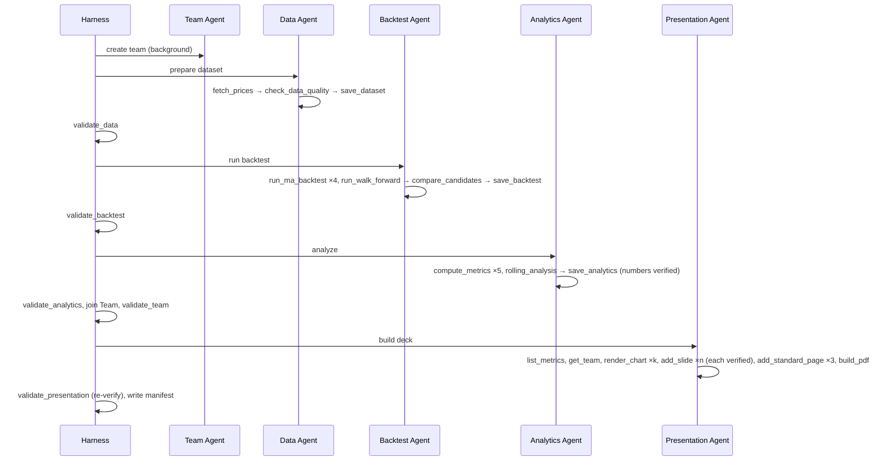

# Architecture

## Principle: agents decide, code computes

```
             ┌──────────── deterministic Python (tested) ────────────┐
 Claude ───► │ tools: fetch · backtest · metrics · charts · validate │ ───► artifacts (JSON/CSV/PNG/PDF)
 agents      └───────────────────────────────────────────────────────┘
   ▲                         │ errors (is_error), guardrail violations
   └─────────────────────────┘
```

The agents choose which tools to call, read the results and write prose. Every number, chart, table and disclosure is produced by code that has unit tests. The guardrails check that every number in the prose came from that code.

## Layers

| Layer | Modules | Notes |
|---|---|---|
| Filesystem | `paths.py` | `confine()` and atomic writes. The only route to disk. |
| Config | `config.py` | Strategy and pipeline parameters, ticker allowlist, windows |
| Domain | `data.py`, `backtest.py`, `analytics.py` | Pure pandas/numpy, no AI |
| Rendering | `charts.py`, `pdf.py` | matplotlib (Agg) and ReportLab. The PDF builder owns all compliance content. |
| Validation | `guardrails.py`, `team.py` | Numeric faithfulness, banned language, team schema |
| Agents | `agents/runtime.py`, `agents/*_agent.py`, `agents/display.py` | Loop, trace, budget, cost; one module per agent |
| State | `context.py` | `RunContext`, shared by the harness and tools for one run |
| Orchestration | `harness.py`, `cli.py`, `run.ps1`, `run.sh` | Stages, validators, manifest, commands |
| Evals | `evals/` | Scorers, red-team cases, runner |

## Sequence of a run



## The agent loop

From `agents/runtime.py`:

1. Call `client.beta.messages.create` with `output_config.effort`, prompt caching, and `fallbacks="default"` with the `server-side-fallback-2026-07-01` beta.
2. Record usage and latency in the trace. Append the full assistant content (append-only history).
3. On `refusal`, return a safe reply. If there's no tool use, return the text.
4. Run the tool calls concurrently. Arguments are checked against the handler's signature. `ToolError`, `ValueError` and `KeyError` become `is_error` results. Unexpected exceptions are traced as `tool_crash` and returned as generic errors.
5. Enforce `max_turns` and the run-wide token budget.

## Extending

- **New metric:** add it to `analytics.series_metrics`, and to `display.PCT_KEYS` or `RATIO_KEYS`. It's then automatically citable, because the faithfulness index reads every numeric leaf of `analytics.json`.
- **New chart:** add a branch to `charts.render` and its name to `CHART_KINDS`. The Presentation Agent's enum updates automatically.
- **New agent:** create a module with `build(ctx)` and `task(ctx)`, add a `Stage` and a validator in `harness.STAGES`, then add scorers.
