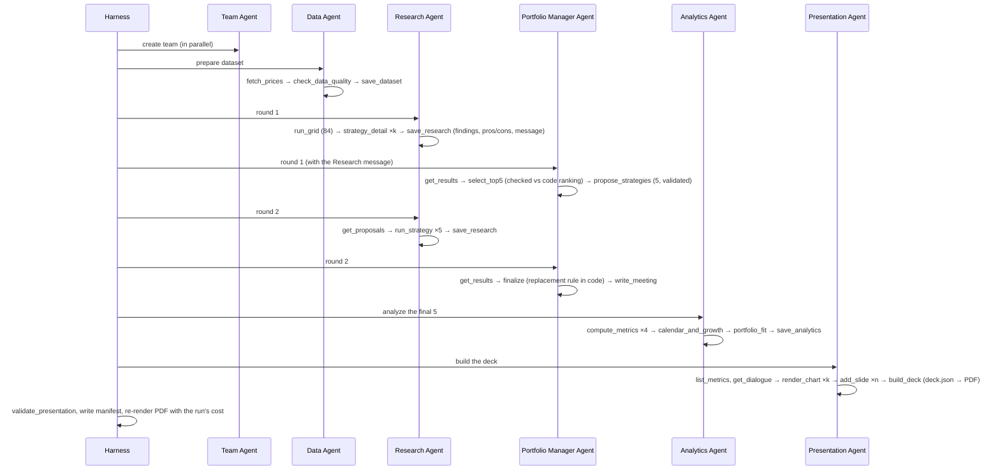

# Architecture

## Principle: agents decide, code computes

```
             ┌──────────── deterministic Python (tested) ─────────────┐
 Claude ───► │ tools: fetch · backtest · rank · score · charts · check │ ───► artifacts (JSON/CSV/PNG) ──► PDF (code)
 agents      └────────────────────────────────────────────────────────┘
   ▲                         │ errors (is_error), hook denials, guardrail violations
   └─────────────────────────┘
```

The agents choose what to examine, interpret results, make the Portfolio Manager's calls and write prose. Every number, ranking, replacement decision, table, chart and disclosure is produced by code that has unit tests. The guardrails check that every number in the prose came from that code.

## Layers

| Layer | Modules | Notes |
|---|---|---|
| Filesystem | `paths.py`, `sandbox.py` | `confine()` and atomic writes are the only route to disk; the audit hook enforces it process-wide |
| Config | `config.py` | Universe, grid, round sizes, proposal bounds, windows |
| Domain | `data.py`, `ranking.py`, `analytics.py` | Pure pandas/numpy, no AI |
| Rendering | `charts.py`, `pdf.py` | Rendered from saved artifacts only; code owns all compliance content |
| Validation | `guardrails.py`, `team.py`, `hooks.py` | Numeric faithfulness, banned language, team schema, tool hooks |
| Governance text | `governance.py` | Descriptions of the harness, guardrails and evals shown in the PDF; tested against the code |
| Agents | `agents/runtime.py`, `agents/*_agent.py`, `agents/views.py`, `agents/display.py` | Loop, trace, budget, cost per tool; one module per agent; shared display views |
| State | `context.py` | `RunContext`, shared by the harness and tools for one run |
| Orchestration | `harness.py`, `cli.py`, `run.ps1`, `run.sh` | Stages, validators, manifest, commands |
| Evals | `evals/` | Scorers, red-team, notebook cross-check, token profile |

## Sequence of a run



Each arrow from the harness is followed by a validator (`harness.STAGES`). A failed check stops the run before the next agent starts.

## The agent loop

From `agents/runtime.py`:

1. Call `client.beta.messages.create`, with `output_config.effort`, prompt caching and server-side fallbacks.
2. Record the call's usage and latency. Attribute its tokens and cost to the agent, and to each tool or context segment it read or wrote.
3. On `refusal`, return a safe reply. If there's no tool use, return the text.
4. Run the requested tool calls concurrently. Each call goes through:
   1. the pre-tool hooks, which may deny it;
   2. argument binding;
   3. the handler;
   4. the post-tool hooks.

   `ToolError`, `ValueError`, `KeyError` and hook denials become `is_error` results the agent can fix. Unexpected exceptions are traced as `tool_crash`.
5. Enforce `max_turns` and the run-wide token budget.

## Rebuilding the PDF

`pdf.build_from_run(run_dir)` loads the following from the run folder and re-renders every chart and page:

- `deck.json`
- `research.json`, `pm.json` and `dialogue.json`
- `analytics.json` and `team.json`
- `strategy_returns.csv`
- `manifest.json`, if present

It doesn't use any agent or API call. The harness uses this same function for the final PDF. `build-pdf runs/<id>` uses it after a run.

## Extending

- **New strategy parameter:** change `RankingConfig`. The grid, prompts, number constants and PDF all read from it.
- **New metric:** add it to `ranking.score` or `analytics`, and to `display.PCT_KEYS` if it is a percentage. It is citable automatically, because the number index reads every numeric leaf.
- **New chart:** add a branch to `charts.render` and its name to `CHART_KINDS`.
- **New agent:** create a module with `build(ctx)` and `task(ctx)`, then add a `Stage` and validator in `harness.STAGES`, its name to `cli.STAGE_NAMES` and `evals.scorers.AGENT_NAMES`, and a row in `governance.AGENTS`.
