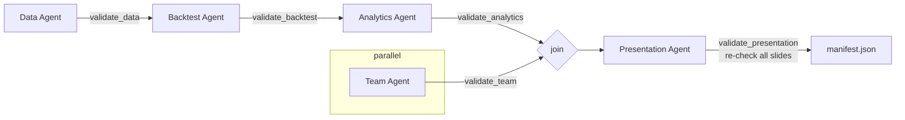

# Harness

`strategy/harness.py` is the orchestrator. It's deterministic code, not an LLM.

## Flow



- The **Team** stage doesn't depend on market data, so it runs in a background thread alongside Data → Backtest → Analytics.
- Each stage runs one agent, then a **validator** checks the artifact. If the check fails, the run stops with `StageError`, so later agents never build on bad input.
- `validate_presentation` re-runs the guardrails on every slide (defense in depth).
- A manifest is written **even when the run fails**: status, error, timing, tokens and cost.

## Run directory

Each run gets a new `runs/<YYYYMMDD-HHMMSS>[-label]/`. Directories are never reused or deleted.

| File | Written by | Contents |
|---|---|---|
| `prices.csv`, `data_report.json` | Data | Clean dataset; quality facts, range and hash |
| `backtest.json`, `returns.csv` | Backtest | Params, selection history, in-sample candidates; daily returns and weights for every series |
| `analytics.json` | Analytics | All windows, rolling, growth, calendar years, findings |
| `team.json` | Team | Validated personas |
| `charts/*.png`, `slides.json`, `presentation.pdf` | Presentation | Deck inputs and output |
| `notes/<stage>.md` | Harness | Each agent's final reply |
| `trace.jsonl` | Runtime | Every model call (stop reason, latency, tokens) and tool call (input, ok, error, latency) |
| `manifest.json` | Harness | Status, version, model, params, data hash and range, seconds, tokens, cost (total and per agent), artifacts |
| `pages/*.png` | `render-pages` | Page renders for review |

## Commands

```powershell
.\run.ps1 run                                   # full pipeline, live data
.\run.ps1 run --offline                         # use data/prices_raw.csv cached by an earlier run
.\run.ps1 stage presentation --from runs\<id>   # redo one stage from saved artifacts (new run dir)
.\run.ps1 eval                                  # score latest run + red-team (free)
.\run.ps1 eval --live --trials 3                # 3 fresh runs, pass rates
.\run.ps1 render-pages runs\<id>                # PNG per page
.\run.ps1 test                                  # unit tests
```

`stage` is the fast path for iterating on one agent. For example, change the Presentation prompt and rebuild only the deck, against the same numbers.

## Why the launcher scripts

The CLAUDE.md guardrails forbid `import os` and touching anything outside the project. matplotlib picks its cache directory from the `MPLCONFIGDIR` environment variable before any project code runs, so the launcher sets it, along with `PYTHONPYCACHEPREFIX`, to `.cache/` inside the project. Charts refuse to render if that hasn't happened.

## Tracing and cost

`Trace` (in `agents/runtime.py`) appends JSONL events under a lock, because tools and the Team stage run concurrently. Usage is accumulated per agent and priced at claude-opus-5-5 rates: $4 per million input tokens, $20 per million output, cache writes at 1.25× input, cache reads at $0.20 per million. Prompt caching is on for every request.

## Configuration

`strategy/config.py`:

- `StrategyConfig`: MA windows, start date, cost in bps, minimum training years, benchmark mix
- `PipelineConfig`: model, turn limit, token budget, offline mode
- `WINDOWS`: analysis periods
