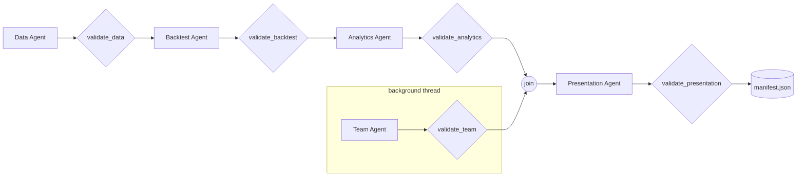

# The harness, in detail

The harness is the deterministic code that runs the agents: the firm's "operations" function. It decides **what runs when**, **what each agent can touch**, **what counts as a finished hand-off**, and **what gets recorded**. No LLM makes these decisions.

| Component | File | Role |
|---|---|---|
| Orchestrator | `strategy/harness.py` | Stages, the parallel Team stage, validators, manifest, single-stage re-runs |
| Agent runtime | `strategy/agents/runtime.py` | The tool-use loop, tool execution, error feedback, trace, budget, cost |
| Run state | `strategy/context.py` | `RunContext`: artifacts, call log and number index shared by the tools of one run |
| Filesystem | `strategy/paths.py` | `confine()`, atomic writes, run directories |
| Configuration | `strategy/config.py` | `StrategyConfig`, `MomentumConfig`, `PipelineConfig`, windows, ticker allowlist |
| CLI and launchers | `strategy/cli.py`, `run.ps1`, `run.sh` | Commands, and environment set-up that keeps caches inside the project |

---

## 1. Pipeline and stages



`run_pipeline(ctx)`:

1. Submits the **Team** stage to a one-worker thread pool. It needs no market data, so it runs alongside the critical path.
2. Runs **Data → Backtest → Analytics** in order on the main thread.
3. Waits for Team, which re-raises its exception if it failed.
4. Runs **Presentation**.
5. Writes `manifest.json` in a `finally` block, so a manifest exists **even when the run fails**, with `status: "failed"` and the error.

`run_stage(ctx, name)`:

1. Builds the agent (`module.build(ctx)`), which binds its tools to this run's context.
2. Runs it on its task (`module.task(ctx)`), a short instruction that names the inputs.
3. Calls the stage **validator**. On failure it raises `StageError`, stopping the run so later agents never build on bad input.
4. Saves the agent's final reply to `notes/<stage>.md`, and logs `stage_start` / `stage_ok` with timings.

### Stage validators (hand-off contracts)

| Validator | Checks |
|---|---|
| `validate_data` | `prices.csv` saved. SPY, IEF, ^IRX and every momentum ETF present. No missing ETF prices. Every momentum ETF has history from at least `start − (max lookback + 1)` months. |
| `validate_backtest` | `backtest.json` saved. All 4 MAs ran. Walk-forward produced at least 5 years. All 5 momentum lookbacks ran. `momentum.json` exists. `MOM*` columns are in `returns.csv`. |
| `validate_analytics` | `analytics.json` saved. All 5 MA windows. 5–9 findings. All 5 comparison windows. |
| `validate_team` | 6 validated members |
| `validate_presentation` | `presentation.pdf` exists. **Every slide re-checked by the number and language guardrails** (defense in depth: the same checks ran when each slide was added). |

### Single-stage re-runs

`run.ps1 stage presentation --from runs/<id>` creates a new run directory, loads the earlier run's artifacts (`RunContext.load_artifacts`), and runs only that stage. This is the fast loop for iterating on one agent's prompt against fixed numbers.

---

## 2. The agent runtime

`Agent.run(task)` in `strategy/agents/runtime.py`:

```
messages = [user: task]
for turn in range(max_turns):
    if trace.total_tokens > token_budget: raise BudgetExceeded
    response = client.beta.messages.create(
        model="claude-opus-5-5", max_tokens=16000, system=prompt, tools=tool_schemas,
        messages=messages, output_config={"effort": effort},
        cache_control={"type": "ephemeral"},                    # prompt caching
        betas=["server-side-fallback-2026-07-01"], fallbacks="default")   # refusal fallback
    trace: usage (input, output, cache write, cache read), latency, stop_reason
    messages.append(assistant: response.content)               # append-only history
    if stop_reason == "refusal": return safe reply
    if no tool_use blocks: return the text reply
    run every tool_use block concurrently (thread pool)
    messages.append(user: [all tool_result blocks])            # one message, all results
raise AgentError("did not finish within max_turns")
```

### Tool execution (`Agent._execute`)

1. **Unknown tool** → `ToolError`.
2. **Argument check:** `inspect.signature(handler).bind(**input)`. Missing or extra arguments become a `ToolError` that names the problem, so the handler never runs with bad input.
3. **Run the handler.** A string result is passed through; anything else is serialized as JSON.
4. **Error handling:**

| Exception | Returned to the model | Rationale |
|---|---|---|
| `ToolError` (domain rule, guardrail, precondition) | `is_error: true`, plus the message | The model reads why and fixes it. Most self-corrections happen this way. |
| `ValueError` / `KeyError` | `is_error: true`, plus type and message | Bad values from the model |
| Anything else | `is_error: true`, "Internal error in <tool>", and a `tool_crash` trace event | The run stays alive, and the crash is visible in evals (`run_health.no_tool_crashes`) |

5. Every call is traced with its input, ok/error, latency, the **exact result text** and its length.

### Limits

| Limit | Value | Where |
|---|---|---|
| Turns per agent | 20 by default, Team 8, Presentation 40 | `PipelineConfig.max_turns_per_agent`, set per agent at build |
| Run-wide token budget | 3,000,000 tokens (input, output and cache combined) | `PipelineConfig.token_budget`, checked before every model call |
| Output per call | 16,000 tokens | `MAX_TOKENS` |
| Effort | low (Data, Backtest, Team), medium (Analytics, Presentation) | Per agent |

---

## 3. Tracing, cost and the manifest

### `trace.jsonl` events (one JSON object per line, written under a lock)

| `type` | Fields | Emitted when |
|---|---|---|
| `start` | agent, task | An agent starts |
| `model` | agent, turn, stop_reason, latency_s, usage {input, output, cache_write, cache_read} | Every model call |
| `tool` | agent, tool, input, ok, latency_s, error, **result**, result_chars | Every tool call |
| `tool_crash` | agent, tool, error (repr) | An unexpected exception |
| `refusal` | agent | A policy refusal |
| `finish` | agent, reply | An agent replies in text |
| `stage_start` / `stage_ok` | stage, seconds | The harness around each stage |
| `run_failed` | error | Any stage failure |

### Cost

Usage is accumulated per agent and priced at claude-opus-5-5 rates:

| Token type | Price per million |
|---|---|
| Input | $4.00 |
| Output | $20.00 |
| Cache write | $5.00 |
| Cache read | $0.20 |

`trace.cost_usd()` is exact for the recorded usage.

### `manifest.json`

| Field | Contents |
|---|---|
| `status`, `error` | Outcome |
| `version`, `model` | Package version, model ID |
| `strategy_params` | MA strategy configuration |
| `offline` | Whether cached prices were used |
| `data_hash`, `data_range` | SHA-256 (16 characters) of the cleaned prices, and the date range |
| `seconds`, `usage_tokens`, `cost_usd`, `cost_by_agent_usd` | Performance |
| `artifacts` | Files written |
| `source_run`, `stage` | For single-stage re-runs |

### Run directory

| File | Producer |
|---|---|
| `prices.csv`, `data_report.json` | Data |
| `backtest.json`, `momentum.json`, `returns.csv` | Backtest. `returns.csv` holds daily returns for every series, plus MA and momentum weights. |
| `analytics.json` | Analytics |
| `team.json` | Team |
| `charts/*.png`, `slides.json`, `presentation.pdf` | Presentation |
| `notes/<stage>.md` | Harness (each agent's final reply) |
| `trace.jsonl`, `manifest.json` | Runtime, harness |
| `token_profile.json` | `evals/token_profile.py` (on demand) |
| `pages/page-NN.png` | `render-pages` (on demand) |

---

## 4. Filesystem and environment guardrails (from CLAUDE.md)

- **`confine(path)`** resolves every path (relative paths from the project root), strips Windows' `\\?\` prefix, and refuses anything outside the project. All reads and writes go through it.
- **Atomic writes:** write `<file>.tmp`, then `Path.replace`. A crash never leaves a half-written artifact.
- **Fresh run directories** (`runs/<timestamp>[-label]`, never reused) and **no deletions** anywhere in the code.
- **Library caches stay inside the project.** The launchers set `MPLCONFIGDIR` and `PYTHONPYCACHEPREFIX` to `.cache/`, because setting environment variables from Python would need `os`. yfinance's cache is set through its API. Charts refuse to render if matplotlib's cache is outside the project.
- **No `import os`.** A test scans every source file.

---

## 5. Commands

```powershell
.\run.ps1 run [--offline]                          # full pipeline
.\run.ps1 stage <data|backtest|analytics|team|presentation> --from runs\<id>
.\run.ps1 eval [--run runs\<id>]                   # 14 scorers + 43 red-team cases (free)
.\run.ps1 eval --live --trials N                   # N fresh runs, pass rates
.\run.ps1 render-pages runs\<id>                   # PNG per page
.\run.ps1 test                                     # 101 unit tests (free)
.venv\Scripts\python.exe evals\crosscheck_momentum.py runs\<id>        # independent re-derivation
.venv\Scripts\python.exe -m evals.token_profile runs\<id>              # exact per-tool token counts
```

## 6. Configuration reference

| Setting | Default | Meaning |
|---|---|---|
| `StrategyConfig.ma_windows` | (5, 20, 50, 200) | MA candidates |
| `StrategyConfig.cost_bps` | 5.0 | MA switching cost |
| `StrategyConfig.min_train_years` | 3 | Walk-forward warm-up |
| `MomentumConfig.lookbacks` | (1, 3, 6, 12, 24) | Momentum sub-strategies |
| `MomentumConfig.slot_weights` | (0.5, 0.3, 0.2) | Top-three weights |
| `MomentumConfig.cash_rules` | **False** (v3, always invested) | True reproduces v2 |
| `MomentumConfig.start` | 2011-01-01 | First invested month |
| `PipelineConfig.model` | `claude-opus-5-5` | All agents |
| `PipelineConfig.token_budget` | 3,000,000 | Per run |
